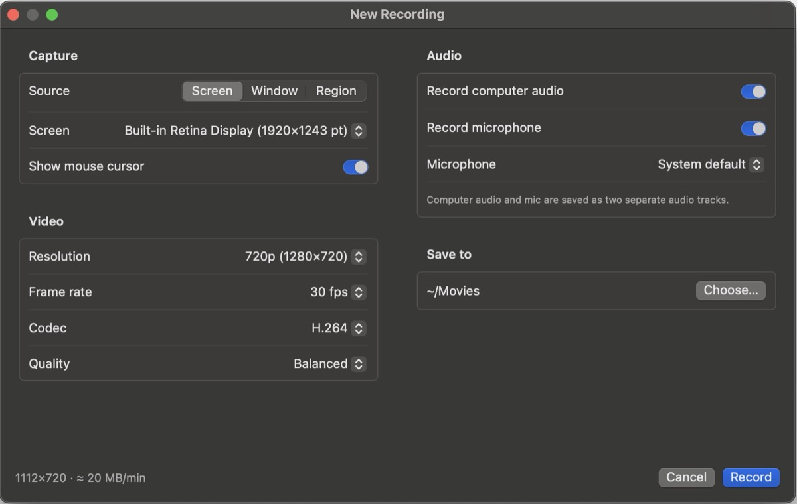

# Recorder

A small, native macOS menu bar screen recorder. It has more control than Kap and far less ceremony than OBS: pick what to record, set the resolution, frame rate, quality, and audio up front, click Record, and click the menu bar icon when you're done.

## Features

- **Record a screen, a single window, or a region you drag out.** A chosen region stays outlined on screen while you configure, so you can see exactly what will be captured.
- **Audio only.** Skip the screen entirely and save computer audio and/or mic as an `.m4a`, about 1 MB per minute.
- **Resolution is set before recording**, not by re-encoding afterward. The GPU scales frames down (never up) to 4K, 1440p, 1080p, 720p, or 480p, or keeps native Retina pixels.
- **Frame rate** from 10 to 60 fps, **H.264 or HEVC**, and a **Quality** setting (Small / Balanced / High). The window shows the resulting size per minute before you start.
- **Computer audio and microphone**, each on or off, with a choice of mic. With both on, video recordings keep them as two separate audio tracks; audio-only recordings mix them into one.
- **Small files, written as you go.** Frames go straight to the hardware encoder, so only compressed video reaches disk. The menu bar shows elapsed time and the file's current size while recording.
- **Crash-tolerant.** Recordings are fragmented `.mov` files, so a crash loses only the last few seconds.
- Settings are remembered between recordings.

## How to install

Requires macOS 15 (Sequoia) or later, on Apple Silicon or Intel.

1. Download `Recorder-x.y.z.zip` from the [latest release](https://github.com/topherhunt/recorder/releases/latest) (all versions are on the [releases page](https://github.com/topherhunt/recorder/releases)).
2. Unzip it and drag **Recorder.app** into your **Applications** folder.
3. **Allow it to open.** Recorder isn't signed or notarized by Apple, so the first launch is blocked with a message that Apple could not verify it. To allow it:
   1. Double-click Recorder, then click **Done** on the warning.
   2. Open **System Settings › Privacy & Security**, scroll down to **Security**, and click **Open Anyway** next to the message about Recorder. Confirm with your password or Touch ID, then click **Open**.

   Alternatively, in Terminal: `xattr -dr com.apple.quarantine /Applications/Recorder.app`, then open it normally.
4. **Grant Screen Recording.** Recorder appears as a ⏺ icon in the menu bar and opens the New Recording window. If the window shows a red permission message, open **System Settings › Privacy & Security › Screen & System Audio Recording**, turn on **Recorder**, then quit Recorder (menu bar icon › Quit Recorder) and open it again. macOS only applies this permission after a relaunch.
5. **Grant Microphone** (only if you record your mic). macOS asks the first time you record with **Record microphone** on. If you declined, turn it on under **Privacy & Security › Microphone**.

Every so often macOS asks whether Recorder may keep capturing "without the system private window picker". This is a normal macOS 15 check for screen recorders that list windows themselves; click **Allow**.

**Updating:** download the new zip and replace the app in Applications. Because Recorder isn't signed with an Apple certificate, macOS may treat the new version as a different app. If recording fails after an update, remove Recorder from the Screen & System Audio Recording list with the **−** button, add it again, and relaunch.

## Using it

1. Click the ⏺ menu bar icon › **New Recording…** (the window also opens at launch).
2. Choose **Screen**, **Window**, **Region**, or **Audio only**. For a region, click **Select Region…** and drag; Esc cancels.
3. Pick resolution, frame rate, codec, quality, and audio, and where to save (default `~/Movies`).
4. Click **Record**. The window closes and the menu bar icon turns into a red ⏹ with a running time and file size.
5. Click the red icon to stop. The file is saved as `Recording <date> at <time>.mov` (`.m4a` for audio only) and shown in Finder.

Quality guide: **Balanced** keeps text crisp and is right for most screen recordings. **Small** suits talking over slides. **High** is for fast motion or fine detail. HEVC makes smaller files at the same quality, while H.264 plays everywhere.

## How it works

ScreenCaptureKit delivers frames already scaled to the output size on the GPU. Each frame goes directly to the hardware H.264/HEVC encoder through AVAssetWriter, so nothing uncompressed is written. Quality sets bits per pixel (`Quality` in `Sources/RecorderCore/Sizing.swift`), so the bitrate, and with it the file size, scales with resolution and frame rate. Output is a `.mov` written in 5-second fragments. Computer audio and mic are separate AAC tracks. Audio-only mode still runs a ScreenCaptureKit stream (that's how macOS exposes computer audio), so it needs the Screen Recording permission too. It discards the frames and writes a fragmented `.m4a`. If both sources are on, the two tracks are mixed into one when you stop, because most players and transcription tools only play an audio file's first track.

## Development

Needs the Xcode Command Line Tools (`xcode-select --install`); full Xcode isn't required.

    bash scripts/build.sh      # -> build/Recorder.app
    open build/Recorder.app

Local builds are signed with a stable self-signed certificate so macOS keeps the Screen Recording grant across rebuilds; see the comment at the top of `scripts/build.sh`. Without that certificate it signs ad-hoc and you re-grant permissions after each rebuild.

### Tests

    swift test                                                            # sizing, quality and naming unit tests
    build/Recorder.app/Contents/MacOS/Recorder --smoke-test 4 /tmp/s.mov  # real 4 s capture of the main display, then checks size/duration/tracks/bytes
    build/Recorder.app/Contents/MacOS/Recorder --smoke-test 4 /tmp/s.m4a  # same, audio only (computer audio, no video track)

The smoke test runs under your terminal's Screen Recording permission.

### Releasing

The version lives in the `VERSION` file, so the repo always records what was last released. To release, bump `VERSION` (e.g. `0.2.0`), commit, push, then run:

    bash scripts/release.sh

This publishes the current `main` commit as GitHub release `v0.2.0` with a `Recorder-0.2.0.zip` attached. It stops with an error if you're not on `main`, if there are uncommitted changes, if `main` doesn't match `origin/main` (push first), or if that version is already released (bump `VERSION`). It then runs the tests, builds a universal (Apple Silicon + Intel) ad-hoc-signed app into `dist/`, zips it, shows a summary, and asks for confirmation. Only then does it create the tag and release on GitHub. Release notes are generated from the commits since the previous release. It never commits or pushes for you. Needs the [GitHub CLI](https://cli.github.com) (`brew install gh`, then `gh auth login`).
